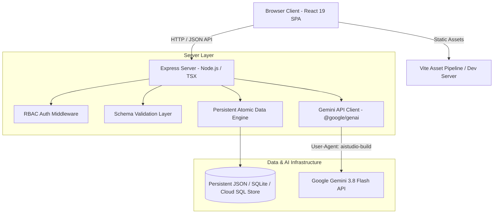

# The EthioTech Initiative — Technical Design Document (TDD)

**Version:** 1.0.0  
**Target Environment:** Full-stack React 19 + Vite 8 + Express 4 Node.js runtime  

---

## 1. System Architecture Diagram

---

## 2. Technology Stack & Decision Rationale

| Layer | Selection | Justification |
|---|---|---|
| **Frontend Framework** | React 19 + TypeScript | High performance, modern hook ecosystem, seamless state management. |
| **Build & Dev Tooling** | Vite 8 + @tailwindcss/vite (Tailwind CSS v4) | Ultra-fast bundling, CSS-first Tailwind engine, zero bloated configuration. |
| **Backend API Server** | Express 4.21 + tsx (TypeScript Execution) | Native Node.js HTTP server running on port 3000, unified with Vite middleware in development and serving built assets in production. |
| **AI Integration** | `@google/genai` (Gemini 3.8 Flash) | High reasoning capability, strict server-side key confidentiality (`process.env.GEMINI_API_KEY`), User-Agent `aistudio-build`. |
| **Styling & Design System** | Tailwind CSS v4 + Plus Jakarta Sans & JetBrains Mono | Custom theme reflecting authentic EthioTech logo (deep navy, subtle gold, cyber emerald). Strict compliance with Universal Frontend Design Constitution. |
| **Icons & Motion** | `lucide-react` + `motion` (v12) | Crisp domain-relevant affordances, hardware-accelerated compositor transitions. |

---

## 3. Data Flow & Request Lifecycle

1. **Client Request:** User actions (e.g., submitting membership application, querying AI mentor, updating project) dispatch typed asynchronous requests to `/api/*`.
2. **Server Routing & Middleware:** 
   - Express parses JSON payloads.
   - For protected administrative routes (`/api/admin/*`), the bearer token / session header is validated against administrative credentials.
3. **Validation & Sanitization:** Incoming payload schemas are verified (email formats, phone numbers, string lengths, required fields).
4. **Data Persistence:** Mutations are written atomically to the persistent database store with write-locks to ensure zero corruption.
5. **AI Interaction:** AI requests route to `server.ts`, which injects domain context (EthioTech guidelines, curricula, tech stacks) and calls `ai.models.generateContent({ model: 'gemini-3.8-flash', ... })`. Response streams or JSON returns directly to client.

---

## 4. Logo Integration Specification

The official EthioTech Initiative logo (`public/assets/aistudio/Club_Logo_4c19d54c.jpg` and `public/images/ethiotech-logo.jpeg`) represents the historic Axum Obelisk re-imagined as a high-tech transmission tower with glowing neural circuit nodes, golden bronze lattice structures, and a silver crescent orbit on a deep navy circular field.

- **Storage Paths:** `public/images/ethiotech-logo.jpeg` & `public/assets/aistudio/Club_Logo_4c19d54c.jpg`.
- **Display Constraint:** Maintain exact aspect ratio 1:1, `object-fit: contain`, no distortion, crisp rendering with dark background integration.
- **Header & Footer:** Used as the primary brand emblem in the navigation bar, footer, and hero presentation.
