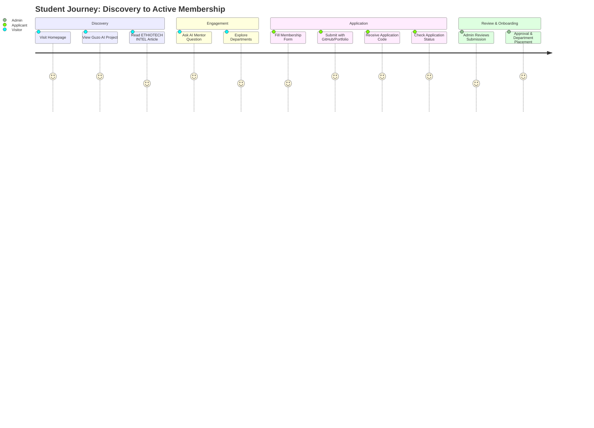

# The EthioTech Initiative — Web Flow and User Journey Document

## 1. Primary User Journeys

---

## 2. Route & Screen Taxonomy

| Route / State | Target Audience | Key Components & Purpose |
|---|---|---|
| `#/` or `Home` | Public | Hero with verified logo, mission statement, featured projects, latest Intel briefs, impact metrics. |
| `#/projects` | Public | Categorized project grid (AI/ML, Web Systems, IoT, AgriTech) with detail drawer/modal. |
| `#/intel` | Public | ETHIOTECH INTEL publication feed, search by topic, tag filtering, article reader view. |
| `#/events` | Public | Upcoming workshops, hackathons, guest seminars, calendar view, registration drawer. |
| `#/departments` | Public | Structure of technical divisions, university chapters, leadership team. |
| `#/apply` | Students | Multi-step membership application form, input validation, success receipt with tracking code. |
| `#/status` | Applicants | Fast lookup by email or application ID with timeline tracking. |
| `#/ai-mentor` | Students / Members | Interactive AI learning assistant powered by server-side Gemini 3.8 Flash. |
| `#/admin` | Leaders / Board | Secure administrative dashboard: review applications, manage projects, publish articles, update events. |

---

## 3. UI State Lifecycle Handling

- **Loading State:** Clean skeleton cards matching dark theme (`bg-slate-800/40 animate-pulse`), avoiding layout shift.
- **Empty State:** High-clarity message explaining why no items are found (e.g., "No articles found matching 'Quantum Computing' — try 'Robotics' or 'AI'"), with an action button to reset filters.
- **Error State:** Human-readable error message with a "Retry" button; non-blocking toasts for transient failures.
- **Access Denied:** Modal prompting for admin PIN/credentials when accessing restricted controls.
